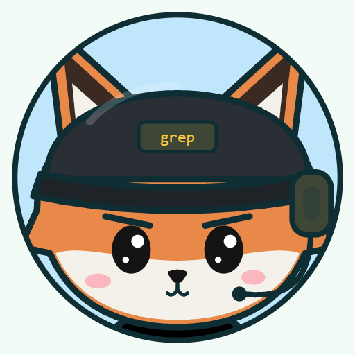

<div align="center">
  
  

  <h1>FoxSnakeCode</h1>
  <p><strong>Tactical Coding Action</strong></p>
  <p>Coding missions, challenges, stealth debugging, boss levels...</p>
  <p><em>Write Python. Slip past the searchlights. Steal the data.</em></p>
  <p><a href="https://trungleduc.github.io/FoxSnakeCode/lab/"><strong>Try it in your browser</strong></a></p>
</div>

## Meet the team

| | Codename | Role | |
| --- | --- | --- | --- |
| 🦊 | **Grep Fox** | Field agent | Sniffs out any word, in any file, in a flash. Your code tells Grep Fox where to go. |
| 🐍 | **Sudo Snake** | HQ | Sneaks past bugs and runs every command with superpowers. Briefs you on every mission. |

## How it plays

1. Click FoxSnakeCode in the launcher to start a new game, or double-click a saved `.fsc` file.
2. Pick the next open level on the map. Solving a level unlocks the one after it, and every 10th level is a boss.
3. Read your briefing from Sudo Snake.
4. Write Python, then press Run.
5. Watch Grep Fox dodge searchlights, lasers and decoys to grab every data chip.

FoxSnakeCode runs in JupyterLab and JupyterLite. Your code runs on a Python kernel, and xeus-python is preferred. The `foxsnakecode` package must be installed in the same environment as the kernel.

## Hints from Sudo Snake

Press **Ask Sudo Snake** during a mission to chat with Sudo Snake. Hints are optional and need [jupyter-ai-lite](https://github.com/jupyterlite/ai) in the JupyterLab or JupyterLite host: install it with `pip install jupyter-ai-lite`. Without it the game works as usual and the button explains how to enable hints. Players connect their own AI provider or sign in with OpenRouter from **Connect AI**. By default the key is kept in memory and cleared when the page reloads. Never put your own API key in a deployed site, because anyone can read it.

Sudo Snake only sees the current level, the player's code and their last result, and has no tools. Its instructions keep it on the game and away from full solutions, but they run in the player's browser and are not a guarantee. The demo site turns off the general AI chat and code completion.

## Install for development

```bash
micromamba create -n cgs -c conda-forge python=3.12 'jupyterlab=4.*' 'nodejs=22' xeus-python jupyterlite-core jupyterlite-xeus pip
micromamba activate cgs
pip install -e ".[ai]"
jupyter labextension develop . --overwrite
jlpm install
jlpm build
jupyter lab
```

Then click FoxSnakeCode in the launcher.

The game logic is in `foxsnakecode/engine.py` and the levels are in `foxsnakecode/missions.json`. After editing the engine, press Stop or restart the kernel to load the new code. After editing the levels, close and reopen the game.

## JupyterLite demo site

The `demo` folder holds a JupyterLite site with xeus-python running in the browser. Build the site with the extension installed:

```bash
pip install build hatchling hatch-nodejs-version hatch-jupyter-builder
jlpm build:demo
```

This builds the `foxsnakecode` wheel and installs it into the site's kernel. The site is written to `demo/_output`, which you can host on any static web server.

After changing the extension, the Python package or the missions, `jlpm update:demo` copies them into an existing `demo/_output` without a full rebuild.

A local demo build keeps files in memory only, so nothing is saved in the browser and reloading the page loses any game you started.

The site deployed to GitHub Pages saves games in the player's browser instead.

Stop restarts the kernel, so the next Run can take a few seconds in JupyterLite.

## Commands players can use

| Command | What it does |
| --- | --- |
| `step(distance)` | Walk forward. A negative number walks backward. |
| `turn(degrees)` | Turn right. A negative number turns left. |
| `turn_to(target)` | Face a chip, a guard or an `(x, y)` position. |
| `distance_to(target)` | Get the distance to a chip, a guard or an `(x, y)` position. |
| `wait(seconds)` | Stay still for a number of seconds. |
| `print(value)` | Show a value under the code. |
| `has_key(color)` | `True` once Grep Fox holds the keycard of that color. |
| `ahead()` | Get how far Grep Fox can walk before a wall, crate or closed door. Unlocked as the Scanner gadget. |
| `hack(answer)` | Next to a terminal, send the answer worked out from its `data`. A wrong answer sets off the alarm. Unlocked as the Hacking kit gadget. |
| `launch_drone()` | Launch the drone and get it back as an object with `step`, `turn`, `turn_to`, `distance_to`, `ahead`, `zap()` and `battery`. Unlocked as the Drone gadget. |
| `fox` | Grep Fox as an object, with the same methods as the drone plus `wait`. |
| `chips` | The list of chips. Each has `x`, `y`, `trapped` and `collected`. |
| `exit_pad`, `intel` | The exit pad and the bonus intel chip, or `None`. |
| `keys`, `doors` | Keycards and doors. Each has `x`, `y` and `color`; doors also have `open`. |
| `lasers` | The list of lasers. Each has `x`, `y`, `w`, `h` and `on`. |
| `terminals`, `fuses` | Terminals (with `data` and `hacked`) and fuse boxes (with `zapped`). |
| `guards` | The list of guards. Each has `x`, `y` and `angle`, and they update as time passes. |

A level is solved when every chip that isn't trapped has been collected and, if the room has an exit pad, Grep Fox stands on it. Searchlights, lasers, trapped chips, a wrong hack answer and being spotted by a guard end the attempt, while crates, walls and closed doors just block the way.

The drone flies over lasers and searchlights, but walls and closed doors stop it, guards can spot it, and every step uses battery. `zap()` next to a fuse box switches off the hazards wired to it.

## Adding levels

Levels are in `foxsnakecode/missions.json`, and their order in the list is their order on the map. The world is 800 by 500 steps, with `x` increasing to the right and `y` increasing downward. An `angle` of 0 faces right.

```json
{
  "title": "FoxSnakeCode",
  "levels": [
    {
      "id": "first-steps",
      "title": "First Steps",
      "instructions": "Reach the chip with `step`.",
      "starterCode": "step(100)\n",
      "scene": {
        "start": { "x": 100, "y": 250, "angle": 0 },
        "chips": [{ "x": 400, "y": 250 }, { "x": 600, "y": 250, "trapped": true }],
        "obstacles": [{ "x": 300, "y": 50, "w": 100, "h": 100 }],
        "hazards": [
          { "x": 600, "y": 100, "r": 50 },
          { "x": 200, "y": 400, "w": 300, "h": 6 }
        ],
        "guards": [
          { "route": [{ "x": 200, "y": 300 }, { "x": 600, "y": 300 }], "speed": 80 }
        ]
      }
    }
  ]
}
```

Optional scene fields:

- `exit`: `{ "x", "y" }`, the pad Grep Fox must reach after the chips.
- `intel`: `{ "x", "y" }`, an optional bonus chip, shown on the map once collected.
- `keys` and `doors`: keycards `{ "x", "y", "color" }` open every door `{ "x", "y", "w", "h", "color" }` of the same color.
- `terminals`: `{ "x", "y", "data", "answer", "color" }`. A correct `hack(answer)` opens the doors of that color.
- `fuses`: `{ "x", "y", "hazards" }`, where `hazards` lists positions in the `hazards` list that a zap turns off.
- `drone`: `{ "battery" }` makes the drone available in the room.
- `values`: names and numbers, like `{ "size": 150 }`, given to the player's code as variables and shown on the map as HQ INTEL.
- A laser with `"on"` and `"off"` seconds blinks.

Optional level fields:

- `variants`: more scenes. The code must solve the main `scene` and every variant, so hard-coded numbers stop working when the rooms differ.
- `par`: `{ "lines", "commands" }` targets for the 2nd and 3rd star. Lines count non-empty, non-comment lines; commands count the orders run (the most of any room).
- `gadget`: `"drone"`, `"scanner"` or `"hack"`. Solving this level unlocks the gadget, which adds its commands to the field manual.

Each level needs a unique `id`. Saved games refer to levels by `id`, so never change one after release; new levels can go anywhere in the list without breaking saves. Add `"boss": true` to mark a boss level.

In `hazards`, an item with `r` is a searchlight and an item with `w` and `h` is a laser. Text between backticks in `instructions` is shown as code.

In `guards`, each guard walks its `route` at `speed` steps per second, then returns to the first point and starts again. Grep Fox is spotted inside a guard's vision cone or by touching the guard, and crates block the cone. Put guard routes where they don't pass through crates.

## The `.fsc` file

A `.fsc` file holds only the player's save and starts empty, so each file is a separate playthrough. Work is saved automatically so players can close it and continue later:

```json
{
  "progress": {
    "currentLevel": "first-steps",
    "solved": ["first-steps"],
    "code": { "first-steps": "step(300)\n" },
    "stars": { "first-steps": 3 },
    "intel": []
  }
}
```

Sharing a file also shares the player's answers.
